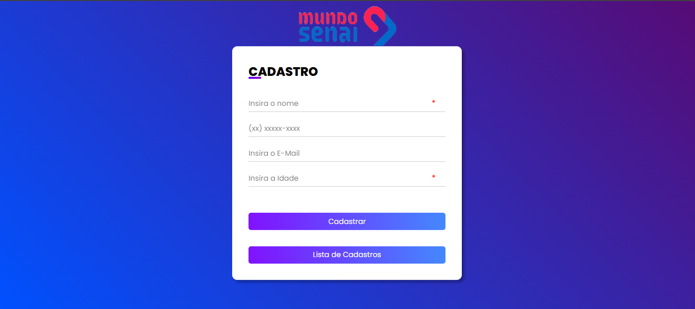

# Cadastro de Visitantes - Mundo Senai



Este projeto foi desenvolvido para o evento **Mundo Senai**, realizado presencialmente, com o objetivo de cadastrar e gerenciar os visitantes do evento de forma prática e eficiente. A aplicação permite o registro de informações básicas dos visitantes e a visualização da lista de cadastros em tempo real.

## Funcionalidades

- Cadastro de visitantes com nome, telefone, e-mail e idade.
- Máscara automática para o campo de telefone.
- Visualização da lista de todos os visitantes cadastrados.
- Interface amigável e responsiva.
- Alerta de sucesso ao cadastrar um novo visitante.

## Tecnologias Utilizadas

- **Node.js** e **Express** para o backend.
- **Express-Handlebars** para renderização de páginas dinâmicas.
- **PostgreSQL** para armazenamento dos dados.
- **Sequelize** para integração com o banco de dados.
- **HTML5**, **CSS3** e **JavaScript** para o frontend.
- Máscara de telefone implementada em JavaScript puro.

## Estrutura do Projeto

```
MundoSenai/
│
├── app.js                # Arquivo principal da aplicação
├── package.json          # Dependências e scripts
├── models/               # Lógica de acesso ao banco de dados
│   ├── db.js
│   ├── Get.js
│   └── Post.js
├── public/               # Arquivos estáticos (CSS, JS, imagens)
│   ├── css/
│   ├── img/
│   └── js/
├── views/                # Templates Handlebars
│   ├── formulario.handlebars
│   ├── lista.handlebars
│   └── layouts/
│       └── main.handlebars
└── README.md
```

## Como rodar o projeto

1. Baixe o arquivo zip do projeto ou rode o comando:
   ```
   git clone https://github.com/DarkMatter015/MundoSenai
   ```
2. No terminal rode o seguinte comando para instalar as dependências do projeto:
   ```
   npm install
   ```
3. Ajeite o arquivo `models/db.js` para suas informações do banco PostgreSQL.
4. Rode o programa:
   ```
   npm run dev
   ```
5. Abra no navegador o endereço: [http://localhost:8000/](http://localhost:8000/)

## Observações

- Este sistema foi utilizado com sucesso durante o evento **Mundo Senai** para facilitar o controle de entrada dos visitantes.
- Sinta-se à vontade para adaptar o projeto para outros eventos ou necessidades.

## Autor

Desenvolvido por alunos da turma de Desenvolvimento Web para o evento Mundo Senai.